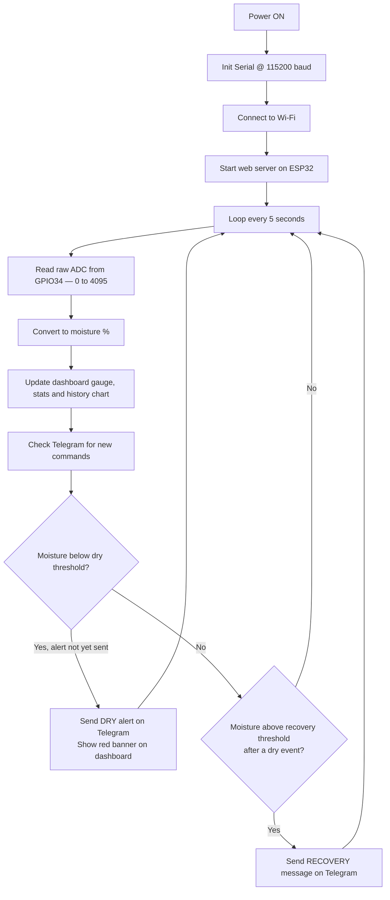

<div align="center">

# 🌱 Soil Moisture Monitoring System
### IoT-Enabled Monitoring using ESP32 with Telegram Bot and Web Dashboard

*A low-cost IoT monitor that reads soil moisture continuously with a capacitive sensor, serves a live web dashboard directly from the ESP32, and sends Telegram alerts when the soil turns dry and again when it recovers.*


Prepared by **M Jayantha Siva Srinivas**
SRM University AP · Department of Skill Development

</div>

---

## ⚙️ How It Works

The system works on one physical fact: **soil moisture changes the capacitance of the sensor's probe.**

A capacitive sensor outputs an analog voltage that the ESP32's 12-bit ADC (0–4095) reads on `GPIO34`. The firmware converts the raw value into a moisture percentage, then does three things at once:

- 🖥️ Serves a **live web dashboard** from the ESP32 itself, reachable from any device on the same Wi-Fi and refreshed every 5 seconds
- 🤖 Answers **Telegram bot commands** (`/start`, `/moisture`, `/status`)
- 🚨 Pushes a **dry alert** when moisture falls below the dry threshold, and a **recovery message** when it rises back above the recovery threshold

> **Higher ADC value → drier soil. Lower ADC value → wetter soil.**
> The relationship is inverse because water in the soil raises the sensor's capacitance, which pulls the output voltage *down*.

---

## 🖥️ Web Dashboard

The dashboard is a single page served by the ESP32. It shows a live status indicator, a colour-coded moisture gauge, device statistics and a moisture history chart. When the soil is dry, a red banner appears and confirms that the Telegram alert was sent.

| Dashboard Element | What It Shows |
|---|---|
| 🟢 Live indicator | Connection status of the dashboard |
| 🎯 Current Moisture gauge | Moisture percentage with a status label (red = dry, green = moist, blue = wet) |
| 📟 Raw ADC | Raw sensor reading, 0–4095 |
| 📶 Wi-Fi signal | Signal strength in dBm |
| 📈 Average / Min / Max | Moisture statistics since power-on |
| ⏱️ Uptime / Readings | Time since boot and number of readings taken |
| 📉 Moisture History | Line chart with a red dashed **dry alert** line and a green dashed **recovery** line |


---

## 🧩 Components

| Component | Specification |
|---|---|
| 🔷 ESP32 Dev Module | Dual-core, Wi-Fi, 3.3V logic, 12-bit ADC |
| 🌱 Soil Moisture Sensor | Capacitive, v1.2, analog output |
| 🔌 Jumper Wires | Male-to-female |
| 🔗 USB Cable | Micro-USB, data-capable (power + programming) |
| 📶 Wi-Fi Network | 2.4 GHz with internet access (required for Telegram) |
| 🤖 Telegram Bot | Created via @BotFather |

---

## 🔌 Circuit Connections

| Signal | ESP32 Pin | Direction |
|---|---|---|
| Sensor analog output (AOUT) | `GPIO34` | Input (ADC1) |
| Sensor power (VCC) | `3.3V` | Power |
| Common ground | `GND` | Reference |

> 💡 `GPIO34` is an **input-only ADC1 pin**. ADC1 is used because ADC2 pins cannot be read while Wi-Fi is active on the ESP32, which would break the readings in this project.

> ⚠️ Power the v1.2 sensor from **3.3V**, not 5V, so the analog output never exceeds the ESP32's ADC input range.

---

## 🔁 Firmware Logic



---

## 🤖 Telegram Bot Commands

| Command | Response |
|---|---|
| `/start` | Welcome message and list of commands |
| `/moisture` | Current soil moisture reading |
| `/status` | Current soil condition (dry / moist / wet) |

**Automatic messages**

| Event | Message |
|---|---|
| Moisture drops below dry threshold | ⚠️ Dry alert |
| Moisture rises above recovery threshold | ✅ Recovery message |

---

## 🛠️ Arduino IDE Setup

| Setting | Value |
|---|---|
| Board | `ESP32 Dev Module` |
| Upload Speed | `115200` |
| Serial Monitor Baud | `115200` |
| Board Package | *esp32 by Espressif Systems* (Boards Manager) |
| Libraries | `UniversalTelegramBot`, `ArduinoJson`, plus built-in `WiFi`, `WiFiClientSecure`, `WebServer` |

> 🔎 Check the `#include` lines at the top of the sketch to confirm the exact library list for your version.

### Configure before flashing

```cpp
const char* ssid     = "YOUR_WIFI_NAME";
const char* password = "YOUR_WIFI_PASSWORD";

#define BOT_TOKEN "YOUR_TELEGRAM_BOT_TOKEN"
#define CHAT_ID   "YOUR_TELEGRAM_CHAT_ID"
```

> 🔐 **Never commit your real Wi-Fi password or bot token.** Keep placeholders in the public repo.

### Open the dashboard

1. Upload the sketch and open the Serial Monitor at `115200`.
2. Note the **IP address** printed after Wi-Fi connects.
3. Enter that IP in a browser on the same network.

---

## 📊 Threshold Logic

The system uses **two separate thresholds** (hysteresis), shown as dashed lines on the history chart, so the alert does not flicker when the reading hovers near a single boundary.

| Threshold | Moisture | Chart Line | Action |
|---|---|---|---|
| Dry alert | 30 % | 🔴 Red dashed | ⚠️ Dry alert sent on Telegram, red banner on dashboard |
| Recovery | 40 % | 🟢 Green dashed | ✅ Recovery message sent after a dry event |

| Soil Condition | Gauge Colour | Status Label |
|---|---|---|
| Dry | 🔴 Red | `Dry - needs water` |
| Healthy | 🟢 Green | `Moist (good)` |
| Saturated | 🔵 Blue | `Wet` |

---

## ✅ Test Results

The sensor was moved between dry, moist and wet conditions while the dashboard was open. Readings below are taken from the dashboard screenshots.

| Condition | Raw ADC | Moisture | Status Label | Wi-Fi Signal | Dashboard Behaviour |
|---|---|---|---|---|---|
| 🔴 Dry | 4095 | 0 % | `Dry - needs water` | -56 dBm | Red banner: *"Soil is dry! Telegram alert sent. Please water the plant."* |
| 🟢 Moist | 2141 | 58 % | `Moist (good)` | -56 dBm | Green gauge, banner cleared |
| 🔵 Wet | 1969 | 68 % | `Wet` | -53 dBm | Blue gauge, banner cleared |

**Session statistics (Wet screenshot):** 20 readings over 4 minutes, average 37 %, minimum 0 %, maximum 68 %.

The history chart shows the moisture rising across the recovery line when the sensor was wetted and falling across the dry-alert line when it was dried, confirming that the dashboard, the thresholds and the Telegram dry alert agree.

---

## 🎯 Field Calibration

Calibrate the sensor before relying on the percentage:

1. Hold the sensor in **open air**. Record the stable reading, which is your **dry reference**.
2. Dip the sensor in **water up to the marked line**. Record the stable reading, which is your **wet reference**.
3. Set these as `DRY_VALUE` and `WET_VALUE` in the sketch, then adjust the dry alert and recovery thresholds to suit your plant.
4. Reflash and test by moving the sensor between dry and wet conditions.

### Factors that affect readings

| Factor | Effect |
|---|---|
| 🧱 Soil composition | Clay holds water longer than sand, so the same reading means different moisture |
| 📏 Probe insertion depth | Insert up to the marked line only, never past the electronics |
| 🔌 Supply voltage quality | A weak USB source shifts the analog output |
| 🌡️ Temperature | Can slightly drift capacitive readings |

---

## ⚠️ Limitations

- 🔌 A raw reading of 4095 (ADC maximum) shows 0 %, so very dry conditions all look the same
- 💾 No long-term data storage: the history chart covers recent readings only
- 📶 Telegram alerts need a working internet connection; the dashboard works on the local network only
- 📡 One sensor per ESP32 in this version
- 💧 The system monitors only; it does not control a pump
- 🔓 Dashboard has no login, so anyone on the same Wi-Fi can view it

---

## 🚀 Future Enhancements

- [ ] Average multiple samples before comparison to suppress ADC noise
- [ ] Add a relay and water pump for automatic irrigation
- [ ] Log readings to a cloud service for long-term history graphs
- [ ] Support multiple sensor nodes across different zones
- [ ] Add deep-sleep mode for battery or solar operation
- [ ] Add dashboard authentication

---


## 👤 Author

**M . Jayantha Siva Srinivas**
B.Tech | Electronics and Communication Engineering |
ESSCI-Certified Embedded Fullstack & IoT Analyst , SRM University(AP)
GitHub: [MJSS-09](https://github.com/MJSS-09)
